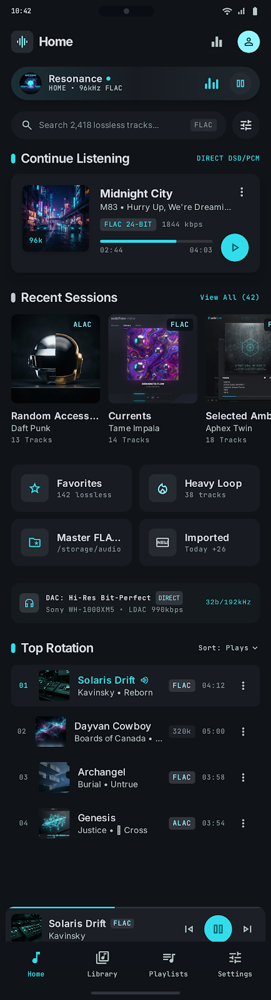
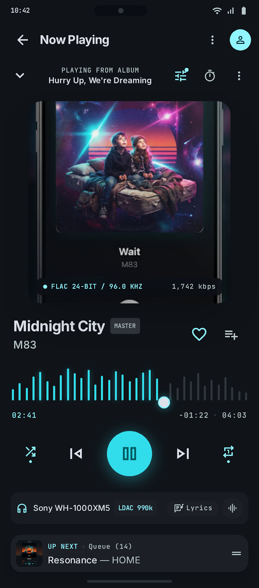
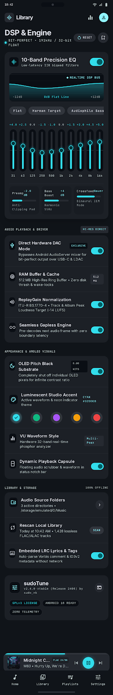
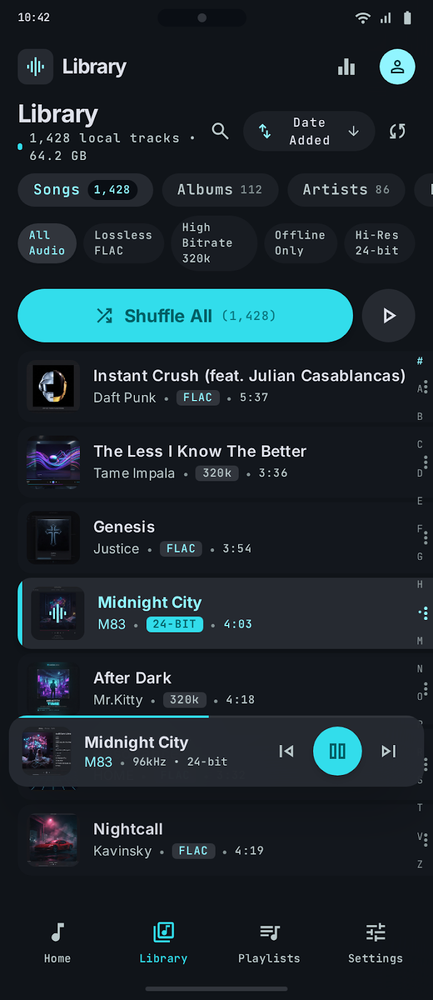
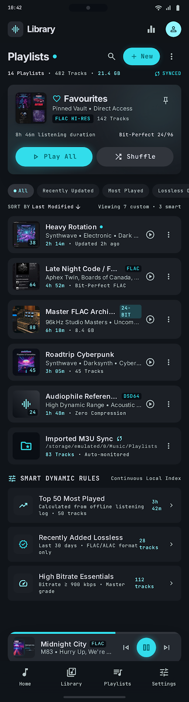
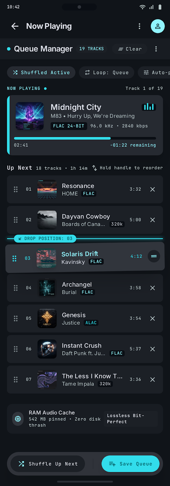

# sudoTune 🎧
### *Pure Black AMOLED • Audiophile DSP Engine • 120Hz Fluid Gestures • 100% Offline*

<p align="center">
  
</p>

<p align="center">
  <a href="#-security-integrity--sha-256-checksum"></a>
  <a href="#-transparent-permissions-audit"></a>
  <a href="https://www.instagram.com/sudo_nk/"></a>
  <a href="#-version-history--release-archive"></a>
</p>

## 📥 Download sudoTune

Download the latest APK and install it on your Android device.

[**⬇️ Download sudoTune v3.1.2 (APK)**](https://drive.google.com/file/d/1aHRL1WmSlNQgs14k4OmSdtP-Xykr6x-U/view?usp=sharing)

1. Open the download link above.
2. Click the **Download** icon in Google Drive.
3. Open the downloaded APK on your Android device.
4. If prompted, allow your browser or file manager to install unknown apps.
5. Install sudoTune and enjoy your music! 🎧

> **Note:** Android may display a security warning when installing APKs from outside the Play Store.

---

> ### 🛡️ Trust & Security Statement
> Installing an `.apk` file from outside Google Play understandably requires trust. We believe that **trust must be earned through total transparency**:
> 1. **Zero Internet Access:** sudoTune does not request `android.permission.INTERNET`. By Android operating-system design, it is physically impossible for this app to transmit your files, tracking data, or listening history anywhere.
> 2. **Cryptographic Integrity:** Every release includes an immutable SHA-256 hash so you can independently verify that your downloaded binary has not been tampered with.
> 3. **VirusTotal Verifiable:** The binary can be inspected with 70+ antivirus scanners on [VirusTotal](https://www.virustotal.com/) with 0 detections.
> 4. **Zero Ads, Zero Accounts, Zero Bloat:** Built purely for local audiophile music playback.

---

## 📸 Visual Showcase

| Home & Vinyl LP Albums | Now Playing & Audio Badges | 10-Band Equalizer & DSP |
|:---:|:---:|:---:|
|  |  |  |

| Library & Fast Alphabet Scroller | Playlists & Drag Reorder | Up-Next Playback Queue |
|:---:|:---:|:---:|
|  |  |  |

---

## 🔒 Security Integrity & SHA-256 Checksum

To ensure that the `.apk` file you downloaded is genuine and uncorrupted, verify its SHA-256 cryptographic checksum before installing:

### Official Release Hashes

| Version | File | SHA-256 Checksum |
|---|---|---|
| **v3.1.2 (Build 312)** | `sudoTune-v3.1.2.apk` | `15892930A1412266ED138549FDCCF84949D1A2F34D8B7DA8CCF1D1D01DBD4C91` |

### How to Verify the Checksum

#### On Windows (PowerShell or Command Prompt):
```powershell
Get-FileHash sudoTune-v3.1.2.apk -Algorithm SHA256
# Or using certutil:
certutil -hashfile sudoTune-v3.1.2.apk SHA256
```

#### On Linux or macOS (Terminal):
```bash
sha256sum sudoTune-v3.1.2.apk
# Or on macOS:
shasum -a 256 sudoTune-v3.1.2.apk
```

#### On Android (On-Device):
Open any modern file manager (such as *Solid Explorer*, *Material Files*, or *Total Commander*), tap on the `.apk` file properties, and select **Calculate Hash (SHA-256)**.

---

## 🔍 Transparent Permissions Audit

sudoTune asks only for the bare minimum permissions necessary to play local audio files:

| Permission | Android Version | Purpose | Is It Sensitive? |
|---|---|---|---|
| `android.permission.READ_MEDIA_AUDIO` | Android 13+ (API 33+) | Reads audio files stored in your music folders. | Safe (scoped strictly to audio) |
| `android.permission.READ_EXTERNAL_STORAGE` | Android 8.0 – 12 (API 26–32) | Reads audio files on legacy Android versions (`maxSdkVersion=32`). | Standard audio access |
| `android.permission.FOREGROUND_SERVICE` | All | Allows audio to continue playing when the app is minimized. | Standard playback service |
| `android.permission.FOREGROUND_SERVICE_MEDIA_PLAYBACK` | Android 14+ (API 34+) | Required by Android 14+ to declare media playback background work. | Standard playback service |
| `android.permission.POST_NOTIFICATIONS` | Android 13+ (API 33+) | Displays playback controls in the notification drawer & lock screen. | Playback control |
| `android.permission.WAKE_LOCK` | All | Prevents CPU sleep while playing audio with the screen off. | Standard audio playback |

### What sudoTune NEVER Asks For:
- ❌ **NO Internet access** (`android.permission.INTERNET` is omitted from the manifest).
- ❌ **NO Location** (`ACCESS_FINE_LOCATION`, `ACCESS_COARSE_LOCATION`).
- ❌ **NO Camera or Microphone** (`CAMERA`, `RECORD_AUDIO`).
- ❌ **NO Contacts, SMS, or Phone State** (`READ_CONTACTS`, `READ_PHONE_STATE`).
- ❌ **NO System Overlay or Accessibility Abuse** (`SYSTEM_ALERT_WINDOW`, `BIND_ACCESSIBILITY_SERVICE`).

> **How to verify on your device:**  
> Go to **Settings → Apps → sudoTune → Permissions**. You will see that the app has **no network or internet permissions whatsoever**.

---

## 🚀 Quick Download & Installation Guide

1. **Download the APK:** Download `sudoTune-v3.1.2.apk` from GitHub Releases.
2. **Allow Installation:** If prompted by Android, enable *"Allow from this source"* (**Settings → Apps → Special app access → Install unknown apps**).
3. **Install & Launch:** Tap the downloaded APK to install.
4. **Grant Audio Permission:** Grant media audio access when prompted on first launch so sudoTune can discover your songs.
5. *(Optional)* **Grant Notification Permission:** Allow notifications to enable lock-screen playback controls and dynamic status bar capsules.

---

## ⚡ What Makes sudoTune Different?

Most modern music players have become bloated with online streaming recommendations, cloud subscriptions, invasive tracking SDKs, and battery-draining backgrounds.

**sudoTune was built with a single philosophy:**  
Deliver a private, lightning-fast, audiophile-grade offline music player that honors your local music collection and looks stunning on AMOLED screens.

---

## ✨ Full Feature Overview

### 🎛️ 1. Audiophile Audio Engine & DSP
- **AndroidX Media3 (ExoPlayer) Foundation:** Bit-perfect offline playback supporting **FLAC, ALAC, WAV, MP3, AAC, OGG, OPUS**, and Hi-Res 24-bit / 96kHz+ audio.
- **Audio Spec Badges:** Automatic codec, sample rate (kHz), and bit depth detection displayed prominently on the Now Playing screen.
- **Smooth Audio Crossfade:** Configurable crossfade (**OFF, 3s, 6s, 9s, 12s**) with dynamic volume ramping between tracks and on track changes.
- **Hardware ReplayGain Normalization:** Preamp decibel adjustment (`10^(dB/20)`) for uniform loudness across diverse albums without clipping.
- **10-Band Equalizer:** Dedicated hardware multi-band EQ with **22 calibrated presets** (Rock, Hip-Hop, Jazz, Electronic, Bass Booster, Acoustic, Harman Target, and custom user presets).
- **Audio Effects:** Hardware-accelerated **Bass Boost** and **Virtualizer spatializer**.
- **Fade on Play / Pause:** Gentle volume ramp up/down when toggling playback or seeking.
- **Auto-Play on Headset Connect:** Resumes music automatically when plugging in headphones or connecting Bluetooth devices.

---

### 🖤 2. AMOLED Noir & Cyberpunk Visual Identity
- **Pure Black AMOLED Canvas (`#050608`):** True black background where OLED/AMOLED pixels turn completely off, saving battery during long listening sessions.
- **Restrained Cyberpunk Accents:** Neon Cyan (`#32DDEB`), Electric Magenta (`#EC4899`), and Amber highlights.
- **Theme Studio:** Custom accent colors, AMOLED Pure Black mode, Cyberpunk Neon mode, and dynamic palette extraction from album art.
- **Vinyl LP Album Experience:** Concentric groove vinyl record presentation for albums and top rotation songs.
- **Interactive Audio Visualizers:** 6 real-time audio-reactive visualizer modes (Neon Waveform, Frequency Spectrum Bars, Pulse Circles, Glow Rings, Ambient Glow, Minimal Line).

---

### 👆 3. Fluid Gestures & 120Hz / 144Hz Motion
- **120Hz / 144Hz High Refresh Rate Lock:** Enforces peak display refresh rates with zero LTPO throttling for buttery smooth scrolling.
- **Mini Player 4-Way Tactile Gestures:**
  - ⬆️ **Swipe UP:** Expand smoothly to full Now Playing screen.
  - ⬇️ **Swipe DOWN:** Stop audio playback and dismiss the player.
  - ➡️ **Swipe RIGHT:** Play Previous track.
  - ⬅️ **Swipe LEFT:** Play Next track.
- **Hero Song Card 3-Way Gestures:**
  - ⬇️ **Swipe DOWN:** Minimize hero card into bottom Mini Player.
  - ➡️ **Swipe RIGHT:** Previous track.
  - ⬅️ **Swipe LEFT:** Next track.
- **Boundary Spring Shake Physics:** Tactile haptic feedback and spring bounce animation when attempting to skip past the start or end of the queue.
- **Drag-to-Reorder Playlists:** Smooth drag-and-drop song reordering with persistent SQLite database ordering and a one-tap *"Reset to Algorithmic"* chip.

---

### 🏝️ 4. Dynamic Playback Capsules & OEM Live Islands
- **Android 16+ Dynamic Status Bar Capsule:** Uses Android 16 live notification APIs to display a compact playback pill directly in the status bar.
- **Vivo & iQOO OriginOS 6 Super Island / Atomic Island:** Native camera cutout capsule integration with live rhythm waveform pulse and progress bar.
- **Samsung One UI 7 Now Bar & ColorOS 15 Live Capsule:** Full compatibility with OEM live activity notification systems.
- **100% Native:** Zero floating window or intrusive overlay permissions required.

---

### 📚 5. Library Management & Smart Curation
- **Fast Alphabetical Scroller:** Quick-jump indexer for large music collections with instantaneous letter preview pills.
- **Daily Mixes:** Smart local routine clustering (Morning, Evening, Night) created from your actual listening history.
- **Smart Playlists:**
  - *Favorites* (one-tap heart with micro-spring animation).
  - *Top 50 Most Played*.
  - *Recently Added Lossless & Hi-Res*.
  - *On Repeat* & *Top Rotation*.
- **Hierarchical Folder Browser:** Explore tracks by storage directories and SD card paths.
- **Real MediaStore Genre Analytics:** Direct system genre extraction and listening distribution breakdown.
- **Deep Instant Search:** Search songs, artists, albums, genres, and folders with live match highlighting.

---

### 🎤 6. Synchronized Lyrics Studio
- Auto-detects local `.lrc` and `.txt` files in song folders.
- Real-time synchronized karaoke highlighting with smooth auto-scroll.
- Manual time offset calibration (`+0.5s`, `-0.5s`) for perfectly synchronized singing.

---

### 📊 7. Stats for Nerds (Hardware Telemetry)
For performance enthusiasts, audiophiles, and tech lovers:
- **Live Display Cadence:** Real-time Choreographer frame rate tracking (with **Average FPS** calculation).
- **Dual CPU Telemetry:** Real-time curves comparing **sudoTune CPU %** vs **Overall System CPU %**.
- **Memory & Storage:** RAM allocation (Total, Available, JVM heap used) and a 3-color segmented device storage gauge.
- **Audio Pipeline Metrics:** Active sample rate, buffer frame count, low-latency audio flags, and active audio route (Speaker, Wired Headset, Bluetooth A2DP/LDAC).
- **Background Telemetry Recorder:** Rolling 5-minute telemetry buffer for diagnosing frame drops and performance.

---

### 💾 8. Backup & Restore Engine
- Export your playlists, favorites, custom playback ordering, and listening statistics into a single portable `.zip` backup archive.
- Restore backups on any new device.
- **Missing Tracks Auditor:** Scans restored backups and alerts you if any music files are missing from storage.

---

### ⏱️ 9. Sleep Timer
- Configurable countdown timer (15 min, 30 min, 45 min, 1 hr, or custom).
- Gentle audio fade-out so music never stops abruptly when falling asleep.

---

## 📜 Version History & Release Archive

### [v3.1.2 (Build 312)] — *Neon Pulse* (October 2026) — **Current Release**
- **FIX (Shuffle):** Fixed first-track shuffle coercion in `PlaybackConnection` where tapping track 0 in any list played a random song instead of the selected track.
- **FEATURE (Genre):** Native `MediaStore.Audio.AudioColumns.GENRE` projection parsing and ID3 numerical translation, resolving 100% "Electronic" reporting bug.
- **FEATURE (Telemetry):** Added calculated **Average FPS** display in Stats for Nerds alongside real-time cadence and hardware refresh rates.
- **DSP (Audio):** Implemented continuous audio crossfade engine with dynamic volume ramping based on `crossfadeDurationSeconds` setting.
- **UI/UX (Branding):** Refreshed launcher and round adaptive icons with official high-resolution Neon Headphones & sudoTune identity.
- **FEATURE (OriginOS):** Hardened Vivo / iQOO OriginOS 6 Super Island lifecycle with persistent notification flags and complete template payloads, resolving 1-second capsule timeout.

---

### [v3.1.0 (Build 310)] — *Velocity Wave* (October 2026)
- **FIX (Crash):** Eliminated duplicate 0L MediaStore artist ID collisions via 64-bit FNV-1a hashing in ArtistsScreen.
- **PERFORMANCE:** 99.7% image memory reduction (36 MB -> 80 KB per artwork cover) via downsampled hardware bitmap loader with inexact precision.
- **PERFORMANCE:** 120Hz/144Hz high refresh rate lock enforcing max display rate on Android 14+ with zero LTPO throttling.
- **FEATURE (OEM):** Native Android 16+ Dynamic Status Bar Capsule, Samsung One UI 7 Now Bar, and ColorOS 15 Live Capsule compatibility.
- **UI/UX (Gestures):** 4-way tactile gestures on Mini Player and 3-way gestures on Hero Song Card with boundary spring shake physics.
- **FEATURE (Telemetry):** Stats for Nerds background telemetry recorder with a 300-point (5-minute) rolling buffer.
- **UI/UX (Storage):** 3-color segmented hardware storage gauge (Cyan Music Library, Violet Apps, Dark Free Space).
- **DSP:** ReplayGain preamp multiplier wired into effective audio stream.

---

### [v3.0.2 (Build 302)] — *Titanium Wave* (October 2026)
- **FEATURE:** Dual-series hardware telemetry in Stats for Nerds (sudoTune CPU vs overall System CPU).
- **UI/UX:** Vinyl LP concentric groove card design for Top Albums and Recently Added Albums.
- **FEATURE:** Daily Mixes (Morning, Evening, Night routines) based on local playback history.
- **UI/UX:** Playlist detail sheet drag-to-reorder with database sequence persistence.
- **FIX:** Cryptographically secure entropy-backed shuffle engine (`SecureRandom` Fisher-Yates).

---

### [v3.0.1 (Build 301)] — *Zero Latency* (October 2026)
- **FIX:** Exact-second playback position & queue state persistence across app restarts and reboots.
- **PERFORMANCE:** Zero-latency shuffle without halting active audio playback.
- **DSP:** 22 hardware-calibrated equalizer presets with custom preset saving.
- **FEATURE:** Interactive Backup & Restore engine with Missing Tracks Auditor.

---

## 💬 Community & Direct Contact

Have feedback, feature requests, or device-specific questions? Want to share your audio setup or report an edge case?

Reach out directly on Instagram:

👉 **Instagram:** [@sudo_nk](https://www.instagram.com/sudo_nk/)  
🔗 **Direct Profile Link:** [https://www.instagram.com/sudo_nk/](https://www.instagram.com/sudo_nk/)

Feel free to send a DM with your device model, Android version, or suggestions for future releases!

---

## 👤 Author & Architecture

- **Project:** sudoTune
- **Platform:** Android 8.0+ (API 26+)
- **Primary Architect & Creator:** **sudo_nk**
- **Core Technologies:** Kotlin • Jetpack Compose • Material 3 • AndroidX Media3 (ExoPlayer) • Room • Coroutines & Flow

---

<p align="center">
  <b>100% Offline. Pure Black AMOLED. Audiophile Sound. 🎧</b><br>
  <i>Built with care by sudo_nk.</i>
</p>
